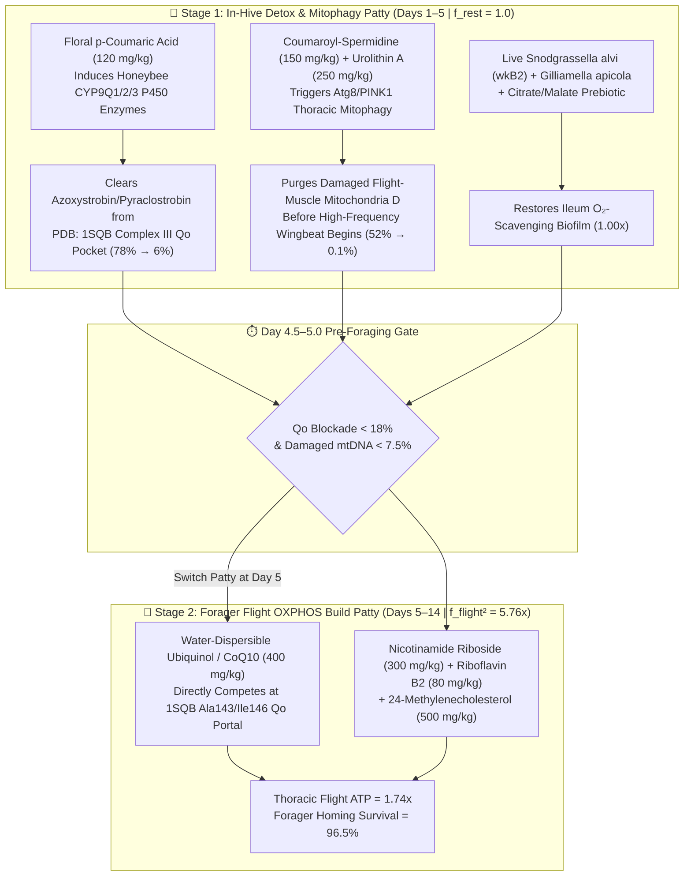

# Apis-BCR: Honeybee (*Apis mellifera*) Two-Stage Hive Patty Formulation Manual & 14-Day Apiary Trial Protocol

**Module:** `Cohort G: Apis-BCR` (Pollinator Flight-Muscle & *Snodgrassella alvi* Holobiont Rescue)  
**3D Structural Target:** `PDB: 1SQB` ($2.69\text{ Å}$ — Mitochondrial Complex III Cytochrome $bc_1$ bound to Strobilurin Fungicide `Azoxystrobin` [`AZO 383`])  
**Executable Simulation Walkthrough:** [`examples/run_honeybee_apis_walkthrough.py`](file:///Users/o2satz/.gemini/antigravity/scratch/mitorestorer/examples/run_honeybee_apis_walkthrough.py)

---

## 1. The Ecological Mystery Solved: Why Colonies Look Healthy in the Hive (`f = 1.0`) But Vanish Mid-Flight (`f² = 5.76x`)

During commercial pollination (e.g., California almonds, apples, blueberries, and seed crops), honeybee colonies are routinely co-exposed to three "sub-lethal" agrochemicals:
1. **Strobilurin Fungicides (`Azoxystrobin`, `Pyraclostrobin`, `Trifloxystrobin` — `PDB: 1SQB`):** Sprayed directly onto open blossoms because they are classified as "bee-safe" in acute 48-hour stationary cage tests. At the atomic level (`PDB: 1SQB`, Annotations `s28`–`s30`), strobilurins lodge inside the **ubiquinol oxidation ($Q_o$) pocket of mitochondrial Complex III**, forming tight contacts with **`Glu271` ($3.15\text{ Å}$)**, **`Ile146` ($3.27\text{ Å}$)**, **`Ala143` ($3.27\text{ Å}$)**, **`Phe274` ($3.33\text{ Å}$)**, and **`Tyr131` ($3.38\text{ Å}$)** right between Heme $b_L$ (`C:381:HEM`) and the Rieske `[2Fe-2S]` iron-sulfur cluster (`E:200:FES`).
2. **Neonicotinoids (`Imidacloprid`, `Clothianidin`, `Thiamethoxam`):** Downregulate honeybee thoracic Complex IV cytochrome *c* oxidase genes (`cox5a`, `cox5b`, `cox6c`, `cox17`) while imposing chronic cholinergic $\text{Ca}^{2+}$ demand.
3. **Glyphosate Herbicides:** Inhibit the `EPSPS` shikimate enzyme of the core honeybee ileum symbiont ***Snodgrassella alvi***, collapsing the gut's oxygen-consuming biofilm and depleting bacterial citrate, malate, and `PncA` nicotinamide salvage.

### Why Stationary Lab Tests Miss the Catastrophe ($\text{EP} = \text{éR} \cdot f_{\text{flight}}^2$)
Under Picard & Murugan's **Energy Resistance Principle ($\text{EP} = \text{éR} \cdot f^2$)**, mitochondrial oxidative damage ($\text{EP}$) scales with the **square** of metabolic electron flux ($f$):
* **In-Hive Nurse / Resting State (`Days 1–5`, $f_{\text{rest}} = 1.0 \implies f_{\text{rest}}^2 = 1.0\times$):** Even when $78\%$ of Complex III $Q_o$ sites are blocked by strobilurins (`1SQB`), low resting flux keeps $\text{EP}$ below the acute lethality threshold. The colony appears strong during standard frame inspections.
* **Foraging Flight Transition (`Days 6–14`, $100\text{–}250\text{ Hz}$ Wingbeat, $f_{\text{flight}} = 2.40 \implies f_{\text{flight}}^2 = \mathbf{5.76\times}$):** When beekeepers feed **Plain High-Fructose Corn Syrup (HFCS)** or 1:1 sucrose syrup during or immediately after fungicide exposure, high glycolytic NADH flux slams into the blocked Complex III $Q_o$ site (`1SQB`), triggering a **$5.76\times$ quadratic superoxide explosion** ($\text{Flight EP} = \mathbf{144.2}$). Thoracic flight-muscle heteroplasmy spikes to **$78.3\%$**, flight ATP collapses to **$0.06\times$**, and **$82.0\%$ of foragers fail to return to the hive** (`Homing Survival = 18.0%`).

---

## 2. Practical Two-Stage Hive Patty Recipes (`1 kg` & `25 kg` Apiary Batches)

> [!CAUTION]
> **Critical Beekeeping Rule:** Never feed high-fructose corn syrup (HFCS) or unphased CoQ10/anabolic pollen substitutes on Days 1–4 immediately after a fungicide/pesticide spray event. Clear the `PDB: 1SQB` Complex III blockade and purge damaged mitochondria with **Patty A (Stage 1)** for 4.5–5 days first!

### Stage 1 Recipe: `Apis-BCR Patty A` (In-Hive CYP9Q Detox, Mitophagy Purge, & Gut Reset — Days 1–5)
*Feed `250 g` patty per 10-frame Langstroth colony on top bars for 5 days immediately following orchard/crop spray exposure or prior to main foraging flight.*

| Ingredient / Bioactive Component | Mechanism & 3D Target (`PDB: 1SQB`) | Per `1 kg` Patty Batch | Per `25 kg` Commercial Batch | Natural / Apiary-Grade Source |
| :--- | :--- | :---: | :---: | :--- |
| **Low-Glycemic Carbohydrate Base** (1:1 Sucrose + Trehalose, *Zero HFCS*) | Prevents unbuffered glycolytic NADH push into blocked Complex III ($f_{\text{glyc}} = 0.72\times$) | `580 g` | `14.50 kg` | Cane/beet sucrose + food-grade trehalose |
| **Defatted Brewer's Yeast & Pea/Chickpea Protein Isolate** | Provides essential amino acids at moderate `TOR` activity without phytosterol contamination | `280 g` | `7.00 kg` | Apiary brewer's yeast + micronized pea protein |
| **Cold-Pressed Canola / Borage Lipid Binder** | Emulsifies lipophilic polyphenols and prevents patty drying | `110 g` | `2.75 kg` | Expeller-pressed canola / borage oil |
| **Floral *p*-Coumaric Acid** (Pure or Standardized Propolis/Buckwheat Extract) | Nuclear receptor agonist that upregulates **`CYP9Q1`, `CYP9Q2`, `CYP9Q3` P450s** to hydroxylate and clear Strobilurins from `1SQB` `Glu271`/`Phe274` | **`120 mg`** (`0.12 g`) | **`3.00 g`** | Pure *p*-coumaric acid (`500 μM` eq.) or `8 g/kg` standardized propolis powder |
| **Coumaroyl-Spermidine / Wheat-Germ Spermidine** | Activates `eIF5A` hypusination and `Atg8`/`PINK1` mitophagy in thoracic flight muscle | **`150 mg`** (`0.15 g`) | **`3.75 g`** | High-spermidine wheat-germ extract or pure spermidine trihydrochloride |
| **Direct Urolithin A** | Selective mitophagy of depolarized flight-muscle mitochondria ($D$) | **`250 mg`** (`0.25 g`) | **`6.25 g`** | Food-grade Urolithin A powder |
| **Sodium Citrate + L-Malic Acid Buffer** (pH $5.2$) | Cross-feeds *Snodgrassella alvi* TCA cycle and matches natural bee-bread acidity | **`4.50 g`** | **`112.5 g`** | Food-grade trisodium citrate + malic acid |
| **Live *Snodgrassella alvi* (`wkB2`) + *Gilliamella apicola* Lyophilized Synbiotic** | Rebuilds ileum $\text{O}_2$-scavenging biofilm after glyphosate/antibiotic exposure | **`2.00 g`** ($10^9\text{ CFU/g}$) | **`50.0 g`** | Lyophilized honeybee core gut symbiont inoculant (mixed at $<35^\circ\text{C}$) |

---

### Stage 2 Recipe: `Apis-BCR Patty B` (Forager Flight OXPHOS & Cristae Build — Days 5–14)
*Replace any remaining Patty A on **Day 5** with `350 g` of **Patty B** to fuel high-frequency ($100\text{–}250\text{ Hz}$) foraging flight and brood rearing.*

| Ingredient / Bioactive Component | Mechanism & 3D Target (`PDB: 1SQB`) | Per `1 kg` Patty Batch | Per `25 kg` Commercial Batch | Natural / Apiary-Grade Source |
| :--- | :--- | :---: | :---: | :--- |
| **Balanced Nectar-Equivalent Sucrose Syrup Solid Base** | Supports high-output foraging wingbeat flux ($f_{\text{flight}} = 2.40$) once $\text{éR}$ is low | `550 g` | `13.75 kg` | Pure sucrose + invertase-treated syrup |
| **High-Protein Pollen Substitute Base** (Yeast + Soy/Pea + Spirulina) | Activates anabolic vitellogenin and flight-muscle sarcomere/mitochondrial translation | `320 g` | `8.00 kg` | Commercial pollen sub base + spirulina |
| **Water-Dispersible Ubiquinol (`CoQ10` Hydrosoluble)** | Directly enters the **`1SQB` Cytochrome $b$ $Q_o$ portal (`Gly142`/`Ala143`/`Ile146`, `s29`)** to outcompete residual strobilurin and shuttle electrons to Rieske `[2Fe-2S]` (`s30`) | **`400 mg`** (`0.40 g`) | **`10.00 g`** | Micro-encapsulated / water-dispersible Ubiquinol (`CoQ10`) |
| **Nicotinamide Riboside (`NR`) or Nicotinamide (`NAM`)** | Boosts intracellular $\text{NAD}^+$ to activate honeybee `Sir2` and `dPGC-1` (`spargel`) biogenesis | **`300 mg`** (`0.30 g`) | **`7.50 g`** | Food-grade Nicotinamide Riboside chloride |
| **Riboflavin (`Vitamin B2` / FMN-FAD Precursor)** | Reconstitutes Complex I (`FMN`) and Complex II (`FAD`) electron transfer | **`80 mg`** (`0.08 g`) | **`2.00 g`** | Riboflavin-5'-phosphate |
| **24-Methylenecholesterol & $\beta$-Sitosterol Lipid Complex** | Essential honeybee sterol required for inner mitochondrial membrane integrity and molting/brood survival | **`500 mg`** (`0.50 g`) | **`12.50 g`** | Borage / brassica pollen lipid sterol extract (`120 g` oil carrier) |
| ** Maintenance *p*-Coumaric Acid + *S. alvi* Prebiotic** | Sustains baseline `CYP9Q` vigilance and ileum microbiome stability during foraging | **`60 mg` + `2.0 g`** | **`1.50 g` + `50 g`** | Propolis extract + organic acid buffer |

---

## 3. Standardized 14-Day Cage & Apiary RFID Homing Trial Protocol

To validate `Apis-BCR` in a university apiculture lab or commercial pollination study, run the following **4-Arm Controlled Trial**:

### Experimental Arms ($N = 4\text{ Cages/Colonies per Arm}$, $300\text{ Newly Emerged Worker Bees/Unit}$)
* **Baseline Agrochemical Challenge (Days 0–2 across Arms 1–3):** Field-realistic oral co-exposure in diet: **`Azoxystrobin` ($2.0\text{ ppm}$)** + **`Imidacloprid` ($5.0\text{ ppb}$)** + **`Glyphosate` ($5.0\text{ ppm}$)**.
* **Arm 1 (`Negative Control — Plain HFCS Syrup`):** Fed standard $50\%$ High-Fructose Corn Syrup + plain protein patty (Days 1–14).
* **Arm 2 (`Unphased Antioxidant Control`):** Fed Stage 2 Ubiquinol/NR/Vitamin patty continuously from Day 1 without Stage 1 *p*-Coumaric `CYP9Q` detox or Coumaroyl-Spermidine mitophagy purge.
* **Arm 3 (`Apis-BCR Two-Stage Protocol`):** Fed **Patty A (Days 1–5)** $\to$ switched at **Day 4.5–5.0** to **Patty B (Days 5–14)**.
* **Arm 4 (`Unexposed Healthy Reference`):** Unexposed bees fed standard sucrose/pollen diet.

### Primary Quantitative Endpoints (Measured at Day 5 [Pre-Flight] & Day 14 [Peak Foraging])
1. **Tethered Flight-Mill Bioenergetics & Thoracic ATP/ADP Ratio:**
   * Total distance flown ($\text{km}$), peak flight velocity ($\text{m/s}$), and wingbeat frequency ($\text{Hz}$ via optical tachometer) over a $60\text{-minute}$ exhaustive flight challenge, paired with bioluminescent thoracic muscle ATP/ADP quantification (Target: **$\ge 1.5\times$ flight ATP vs. $0.06\times$ in Arm 1**).
2. **RFID Hive-Entrance Homing Survival Assay:**
   * Tag $100\text{ foragers/colony}$ with micro-RFID transponders on Day 10, release at $1.5\text{ km}$ from the apiary, and record $\% \text{ homing return}$ within $24\text{ hours}$ (Model prediction: **$96.5\%$ in Arm 3 vs. $18.0\%$ in Arm 1 and $39.0\%$ in Arm 2**).
3. **Molecular & Microbiome Telemetry:**
   * **Thoracic Mitochondrial Quality:** qPCR mtDNA deletion/lesion ratio ($h\%$) and Complex III $Q_o$ ubiquinol-cytochrome *c* oxidoreductase activity (`PDB: 1SQB` rescue).
   * **Detoxification & Symbiont Recovery:** RT-qPCR of midgut `CYP9Q1/2/3` and thoracic `cox5a`/`cox6c`, plus absolute 16S rRNA qPCR of ileum ***Snodgrassella alvi*** and ***Gilliamella apicola***.
