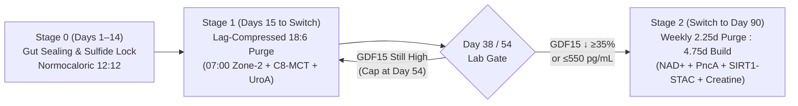

# Bioenergetic Circuit Reset (BCR): Clinician & Patient Field Manual and Lab Gating Worksheet

> [!IMPORTANT]
> **Purpose of This Field Manual:** Translates the biophysical ODE equations ([sim_bioenergetic_reset.py](file:///Users/o2satz/.gemini/antigravity/brain/e55fbd0d-7b92-471e-b9ba-63a180b98a1f/scratch/sim_bioenergetic_reset.py)), interactive simulator ([bcr_simulator.html](file:///Users/o2satz/.gemini/antigravity/brain/e55fbd0d-7b92-471e-b9ba-63a180b98a1f/bcr_simulator.html)), and 5-structure 3D atomic proofs ([Biomolecular Structure Viewer](sidecar://science/biomolecular_structure_viewer/ui.html)) from [bcr_clinical_protocol.md](file:///Users/o2satz/.gemini/antigravity/brain/e55fbd0d-7b92-471e-b9ba-63a180b98a1f/bcr_clinical_protocol.md) into a day-by-day execution checklist and lab gating worksheet.

---

## 1. Step-by-Step Cohort & Genotype Track Selector (Day 0 Intake)

Before starting Stage 0, match the patient's primary clinical presentation and baseline SNP panel to one of the **4 Precision Cohorts** and apply the **Genotype Override Rules**:

### A. Primary Clinical Cohort Assignment

| Cohort Track | Primary Clinical Presentation | Target Tissue Turnover ($\tau_{\text{tissue}}$) | Core Protocol Module | Expected Stage 1 $\rightarrow$ Stage 2 Switch Window |
| :--- | :--- | :---: | :--- | :---: |
| **Cohort A: Peripheral Metabolic & Sarcopenic** | Type 2 Diabetes / Insulin Resistance (HOMA-IR $> 2.5$), Metabolic Syndrome, Sarcopenic Myopathy, Chronic Fatigue | Fast–Medium (`1.00x–1.35x`) | Base Two-Stage BCR | **Day 38 – Day 54** |
| **Cohort B: Neuro-Cognitive (*APOE4 / TOMM40*)** | Prodromal MCI / Early Alzheimer's Risk, *APOE* $\varepsilon4$ (`rs429358 C`) carrier, Age-Related Cognitive Decline | Slow (`0.65x`) | Base BCR + **3-Part Neuro-BCR Stack** | **Day 28 (WT) – Day 54 (Risk)** |
| **Cohort C: Drug-Resistant / Refractory Epilepsy** | Focal or Generalized Seizures refractory to $\ge 2$ ASMs, or prior "Secondary Escape" on classic ketogenic diet | Slow (`0.68x` $\text{PV}^+$ Interneurons) | **`Epi-BCR` Module** (Ketone-Maintained Stage 1 & 2 + `gadB`/Sulfide Guard) | **Day 31 – Day 42** |
| **Cohort D: Treatment-Resistant MDD (TR-MDD)** | Major Depressive Disorder with anhedonia / psychomotor slowing, non-response to SSRIs or rapid relapse after Ketamine/rTMS | Slow (`0.65x` Prefrontal Spines) | **`Affective-BCR` Module** (`IDO1/QUIN` Blockade $\rightarrow$ Stage 2 Synaptogenesis) | **Day 30 – Day 38** |

---

### B. Genotype-Specific Override Rules (From 23andMe / Clinical Exome / Targeted SNP Panel)

| Gene & Variant | How to Read the Lab Report | 3D Structural Reference | Mandatory Adjustment to Patient's Regimen |
| :--- | :--- | :--- | :--- |
| ***FUT2* `rs601338`** (`chr19:48703417:G>A`) | `A/A` Homozygous (**Non-Secretor**, 22.5% of population) | — | **Cannot rely on dietary pomegranate/walnuts for Urolithin A.** Must take **direct postbiotic Urolithin A ($1,000\text{ mg}$)** + **$2\text{ g/day}$ 2'-Fucosyllactose (2'-FL HMO)** + live *Akkermansia muciniphila* ($10^9\text{ AFU}$). |
| ***MTHFR* `rs1801133`** (`C677T` / `Ala222Val`) | Coding `C/T` (Het) or `T/T` (Hom) *(Genomic minus-strand `G/A` or `A/A`)* | **PDB: `6FCX`** (`s1`–`s4`) [6FCX/pdb_00006fcx.cif](file:///Users/o2satz/.gemini/antigravity/brain/e55fbd0d-7b92-471e-b9ba-63a180b98a1f/6FCX/pdb_00006fcx.cif) | Val222 sterically pries the $\alpha6$ helix (`Lys217`) away from `FAD 701`. Must take **Riboflavin-5-Phosphate (Vitamin B2, $50\text{ mg/day}$)** + **L-5-MTHF ($800\text{ }\mu\text{g}$)** + **Creatine Monohydrate ($5\text{ g/day}$)** (spares 40% of SAMe). |
| ***APOE* `rs429358` + *TOMM40* `rs2075650`** | `T/C` ($\varepsilon3/\varepsilon4$) or `C/C` ($\varepsilon4/\varepsilon4$) | **PDB: `1B68`** (`s5`–`s8`) & **PDB: `7CK6`** (`s9`–`s12`) | `Arg112–Glu109` ($2.53\text{ Å}$) salt bridge drives C-terminal fragments that clog the 19-stranded `TOMM40` pore (`7CK6`). **Must add TUDCA ($500\text{ mg}$) + Sulforaphane ($20\text{ mg}$) + Citicoline ($500\text{ mg}$) + LPC-DHA ($1,000\text{ mg}$)** before increasing mitophagy. |
| ***PINK1* Class I Variant** (Catalytic / ATP-Pocket) | e.g., `rs1043424` (`Ala339Thr`), `Gly309Asp`, kinase-cleft missense | **PDB: `6EQI`** (`s15` `Met290` Gatekeeper Pocket) | `SEP202–Arg282` ($2.22\text{ Å}$) clamp and `Insertion-3` loop remain intact. **Directly rescued by Kinetin / N6-furfuryladenine (`KTP` neo-substrate)** during Stage 1 Purge windows. |
| ***PINK1* Class II Variant** (`Ins3` / Ubiquitin-Cradle) | Mutations in `Insertion-3` (`265–285`), `Arg282`, or `Glu269` Ub interface | **PDB: `6EQI`** (`s13`, `s14`, `s16` Ubiquitin Cradle) | **Warning: Kinetin (`KTP`) monotherapy will fail** ($h = 47.6\%$) because `PINK1` cannot dock `Ubiquitin Ser65`. **Must add Trehalose ($15\text{ g}$) + High-Dose Spermidine ($12\text{ mg}$)** (TFEB macro-autophagy bypass) + **Nocturnal Melatonin ($3\text{ mg}$) + Glycine ($3\text{ g}$)** (astrocytic N3 transmitophagy). |
| ***PPARGC1A* `rs8192678`** (`Gly482Ser`) | `C/T` (Het, `0.78x`) or `T/T` (Hom, `0.58x`) | **PDB: `4ZZJ`** (`s17`–`s20` `SIRT1 Glu230` Hinge) | Lowers `PGC-1α` docking affinity in the `SIRT1` tunnel (`Val412/Arg446`). In Stage 2, **must pair NR/NMN ($500\text{ mg}$) + *PncA* Probiotic with an allosteric `SIRT1 Glu230` STAC activator (Resveratrol/Pterostilbene $250\text{ mg}$ + PQQ $20\text{ mg}$ + Tributyrin $500\text{ mg}$ BID)**. |
| ***SOD2* `rs4880`** (`Val16Ala` MTS) | Coding `T/T` (`Val/Val` slow MTS import across `TOMM40` `Leu77–Glu105`) | **PDB: `7CK6`** (`s10` Internal MTS Helix) | Reduces mitochondrial matrix MnSOD import by 35%. **Maintain continuous GlyNAC ($1.8\text{ g}$ NAC + $1.8\text{ g}$ Glycine) + CoQ10/Ubiquinol ($200\text{ mg}$)** across all 90 days. |

---

## 2. Daily Hour-by-Hour Execution Checklists (Stages 0, 1, and 2)

### Phase 0 Checklist (Days 1–14): Mucosal Sealing, Methylation Priming, & Sulfide Lock
*Goal: Seal the gut barrier, establish the $\text{H}_2\text{S}$ sulfide blockade, and load `FAD` (`6FCX`) and `PC1 401` (`7CK6`) before starting fasting stress.*
* **07:30 AM (With Breakfast):**
  * [ ] **GlyNAC:** $1,800\text{ mg}$ N-Acetylcysteine (NAC) + $1,800\text{ mg}$ Glycine
  * [ ] **`MTHFR` (`6FCX`) Cofactor Stack:** $50\text{ mg}$ Riboflavin-5-Phosphate (Vitamin B2) + $800\text{ }\mu\text{g}$ L-5-MTHF + $300\text{ mg}$ Magnesium Taurate (or Magnesium L-Threonate $2\text{ g}$ in Cohorts B/C/D)
  * [ ] **Sulfide Blockade:** $150\text{ }\mu\text{g}$ Molybdenum Glycinate + $500\text{ mg}$ Cranberry/Pomegranate Polyphenol Extract
  * [ ] *(Cohorts B, C, D Only — `7CK6 TOMM40` Gate Unblocking):* **TUDCA ($500\text{ mg}$) + Sulforaphane ($20\text{ mg}$) + Citicoline ($500\text{ mg}$) + LPC-DHA ($1,000\text{ mg}$)**
* **12:30 PM & 06:30 PM (With Mediterranean Meals, 12:12 Eating Window):**
  * [ ] **Microencapsulated Tributyrin:** $500\text{ mg}$ twice daily with lunch and dinner
  * [ ] **Mucosal Synbiotic:** Live *Akkermansia muciniphila* ($10^9\text{ AFU}$) + *Bifidobacterium longum* + **$2\text{ g}$ 2'-Fucosyllactose (2'-FL HMO)**

---

### Stage 1 Checklist (Days 15 to Switch Day [38–54]): Lag-Compressed Daily 18:6 De-Heteroplasmy Purge
*Goal: Compress the 13.5-hour liver glycogen lag down to 6.0 hours (or 4.0 hours in neurons) to achieve 12–14 hours/day of selective mutant mtDNA ($D$) clearance while holding $\text{NAD}^+$ boosters low.*

| Time of Day | Physiological State | Action & Dosing Checklist | Cohort-Specific Add-Ons (Cohorts B, C, D) |
| :--- | :--- | :--- | :--- |
| **06:00 PM (Prior Evening)** | **Start of 18-Hour Fast** | Finish low-glycemic dinner by 18:00. Zero calories after 18:00. | — |
| **09:30 PM (Pre-Sleep)** | **Hour 3.5 of Fast** *(N3 Glymphatic Window)* | Hydrate with water + electrolytes (sodium/potassium/magnesium). | **Cohorts B, C, D:** **$3\text{ mg}$ Melatonin + $3\text{ g}$ Glycine** (activates N3 slow-wave sleep astrocytic **transmitophagy**). |
| **07:00 AM (Wake-Up)** | **Hour 13 of Fast** *(Lag-Compressor Kickoff)* | 1. **20–25 min Fasted Zone-2 Cardio** (brisk walk/cycle at $60–70\%\text{ HR}_{\text{max}}$ to empty remaining hepatic glycogen). 2. **$10–15\text{ mL}$ C8-MCT Oil** (+ $1,000\text{ mg}$ ALCAR if *SLC22A5/CPT2* carrier). 3. **$1,000\text{ mg}$ Postbiotic Urolithin A** + **$6\text{ mg}$ Spermidine**. | **Cohorts B, C, D:** Upgrade to **$15\text{ g}$ Trehalose + $12\text{ mg}$ Spermidine** + **Kinetin (`KTP` precursor)**. **Cohort C (`Epi-BCR`):** Add **$10\text{ g}$ Exogenous D-BHB** to maintain `K_ATP` channel hyperpolarization. |
| **07:30 AM – 12:00 PM** | **Hours 13.5 – 18.0** *(Peak Mitophagy Zone)* | **Active De-Heteroplasmy Window:** Cellular mTORC1 is off, ULK1(`Ser757`) is dephosphorylated, and `PINK1` (`6EQI`) + `TFEB` selectively clear damaged $D$. **CRITICAL RULE:** **Do NOT take NR, NMN, Niacin, or protein/leucine during this window.** | — |
| **12:00 PM (Break-Fast)** | **Start of 6h Feed Window** | Break fast with low-glycemic Mediterranean meal ($1.0–1.2\text{ g/kg/day}$ total protein) + **Tributyrin ($500\text{ mg}$)** + **2'-FL HMO ($2\text{ g}$)** + **GlyNAC** + **Riboflavin B2 ($50\text{ mg}$)** + **Molybdenum ($150\text{ }\mu\text{g}$) + Polyphenols ($500\text{ mg}$)**. | **Cohorts B, C, D:** **TUDCA ($500\text{ mg}$) + Sulforaphane ($20\text{ mg}$) + Citicoline ($500\text{ mg}$) + LPC-DHA ($1,000\text{ mg}$)**. **Cohort C (`Epi-BCR`):** Add ***Parabacteroides merdae* + *L. plantarum* (`gadB`) + $25\text{ mg}$ P5P (B6)**. **Cohort D (`Affective-BCR`):** Add **$2\text{ g}$ High-EPA Omega-3 + $500\text{ mg}$ Curcumin Phytosome** (`IDO1/QUIN` block). |
| **05:30 PM (Dinner)** | **End of 6h Feed Window** | Second Mediterranean meal + **Tributyrin ($500\text{ mg}$)**. Close eating window at 18:00. | **Cohort C (`Epi-BCR`):** Include $15\text{ mL}$ C8-MCT with dinner to sustain nocturnal `D-BHB`. |

---

### Stage 2 Checklist (From Biomarker Switch Day [38–54] to Day 90): Weekly Anabolic Expansion (`2.25d Purge : 4.75d Build`)
*Goal: Once mutant mtDNA ($D$) is cleared below 8%, activate `SIRT1` (`4ZZJ`) and `PGC-1α` for 4.75 days every week to rapidly repopulate cells with healthy wild-type ($W$) mitochondria while keeping 2.25 days/week of maintenance cleaning.*

* **Days 1–2 of Each Week (e.g., Monday 18:00 to Thursday 00:00 — `2.25 Days Maintenance Purge`):**
  * [ ] Follow the exact **Stage 1 Lag-Compressed 18:6 Schedule** above (`Morning Zone-2 + C8-MCT + Urolithin A 1,000 mg`; hold NR/NMN off).
* **Days 3–7 of Each Week (Thursday Morning through Monday 18:00 — `4.75 Days Anabolic Build`):**
  * [ ] **07:30 AM (`SIRT1 4ZZJ` Biogenesis Ignition with Breakfast):**
    * **$\text{NAD}^+$ Flux Stack:** **$500\text{ mg}$ Nicotinamide Riboside (NR) or NMN** + ***PncA*-Active Synbiotic** (*Lactiplantibacillus plantarum* / *L. fermentum* / *Bifidobacterium*)
    * **`SIRT1 Glu230` (`4ZZJ`) Allosteric Clamp (Especially for *PPARGC1A* `rs8192678` Carriers):** **$250\text{ mg}$ Micronized Resveratrol or Pterostilbene** + **$20\text{ mg}$ PQQ (Pyrroloquinoline Quinone)** + **$500\text{ mg}$ Tributyrin** + **$15–20\text{ g}$ Prebiotic Resistant Starch / Acacia Fiber**
    * **Spatial ATP Grid & `MTHFR` (`6FCX`) Stack:** **$5\text{ g}$ Creatine Monohydrate** + **$50\text{ mg}$ Riboflavin B2** + **$200\text{ mg}$ Ubiquinol (CoQ10)**
  * [ ] **Afternoon / Exercise Stimulus:**
    * **3x/week Resistance Training or High-Intensity Interval Training (HIIT)** followed by anabolic meal ($1.4–1.6\text{ g/kg/day}$ protein + $100–150\text{ g/day}$ complex cellular carbohydrates; *Note: in **Cohort C (`Epi-BCR`)**, keep carbohydrates low-glycemic $<60\text{ g/day}$ paired with C8-MCT $15\text{ mL}$ TID so blood ketones stay $\ge 1.5\text{ mmol/L}$*).
  * [ ] **Cohort D (`Affective-BCR`) Stage 2 Synaptogenesis Add-On:**
    * Add **$1,500\text{ mg/day}$ Acetyl-L-Carnitine (ALCAR)** (epigenetic histone acetylation of *BDNF* and *mGluR2* promoters). *If clinical low-dose Ketamine or rTMS is prescribed by the psychiatrist, schedule sessions **exclusively on Friday/Saturday (Stage 2 Build Days)** when cellular $\text{éR}$ and `QUIN` are low so newly formed dendritic spines lock in permanently ($1.24\times$).*
  * [ ] **Cohort E (`PD-BCR` / Parkinson's Disease `SNc`) 3-Stage Checklist Add-On:**
    * **Stage 0 Mandatory Lysosomal Unblocking (`PDB: 2NSX` — Start 14 Days *Before* Mitophagy):** **High-Dose Ambroxol ($600–1,200\text{ mg/day}$)** (chaperones `GBA1 Asn370Ser` across the ER into the lysosome) + **High-Dose Spermidine ($15\text{ mg/day}$, `ATP13A2/PARK9` substrate) + Trehalose ($15\text{ g/day}$)** + **TUDCA ($1,000\text{ mg/day}$) + Sulforaphane ($20\text{ mg/day}$, `DJ-1` redox rescue)** + **Braak Gut–Vagal Shield (`Molybdenum 150 μg + EGCG 400 mg + Pomegranate/Cranberry Polyphenols + Tributyrin 500 mg BID` to block *Desulfovibrio* $\text{H}_2\text{S}$, *Enterobacteriaceae* Curli amyloid seeding, and *Enterococcus faecalis* `TyrDC` L-DOPA loss)**. *Critical Rule (Discovery 6): Never initiate `Urolithin A + Kinetin` mitophagy in `GBA1/LRRK2` PD until Stage 0 lysosomal unblocking has run for 14 days.*
    * **Stage 1 (`D-BHB` Complex II Bypass & `VMAT2` Sequestration):** Take **C8-MCT ($15\text{ mL}$ BID) + Exogenous `D-BHB` ($10\text{ g}$)** alongside **Kinetin ($250\text{ mg}$, `6EQI`) + Direct Urolithin A ($1,000\text{ mg}$)** to power vesicular `VMAT2` dopamine packaging and prevent cytosolic Dopamine-Quinone (`DA-Q`) toxicity. Separate oral Levodopa/Carbidopa from high-protein meals by $\ge 45\text{ minutes}$ to avoid `LAT1` transporter competition.
    * **Stage 2 (`NADPARK/NOPARK` Biogenesis):** Escalate **Nicotinamide Riboside (`NR`) to $1,000\text{ mg/day}$** (the clinically validated `NADPARK`/`NOPARK` dose) + ***PncA* Synbiotic + `SIRT1` STAC (`4ZZJ`) + Riboflavin B2 ($50\text{ mg}$, `6FCX`, preventing L-DOPA-induced homocysteine elevation) + Creatine ($5\text{ g}$) + Ubiquinol/CoQ10 ($300\text{ mg}$) + Citicoline/LPC-DHA (`7CK6`)**.

---

## 3. The Day-38 & Day-54 "Traffic Light" Lab Gating Worksheet

Order this panel at **Day 0 (Baseline)**, **Day 38 (Gate Check 1)**, **Day 54 (Gate Check 2)**, and **Day 90 (Final Outcome)**.

### A. Core Gating Biomarkers (When to Flip from Stage 1 Purge to Stage 2 Build)

| Biomarker & Assay Type | Clinical Meaning in BCR Model | 🟢 GREEN (Switch to Stage 2 Immediately) | 🟡 YELLOW (Continue Stage 1 until Day 54) | 🔴 RED (Trigger Clinical Override / Safety Rule) |
| :--- | :--- | :--- | :--- | :--- |
| **1. Fasting Plasma GDF15** *(ELISA / Roche Elecsys, $\text{pg/mL}$)* | Primary blood readout of cellular $\text{EP} = \text{éR} \cdot f^2$ and residual heteroplasmy ($h\%$) | **Dropped $\ge 35\%$ from Day 0** OR absolute level **$< 550\text{ pg/mL}$** | Dropped $15\%–34\%$ from Day 0 (typical at Day 38 in slow `PINK1/FUT2` carriers) | **Rose $> 15\%$ above Day 0:** Check for hidden $\text{H}_2\text{S}$ bloom, unblocked *APOE4* `TOMM40` pore, or overtraining. |
| **2. Morning Capillary $\beta$-OHB (Ketones) at Hour 15 of Fast** *(Precision Xtra / Keto-Mojo, $\text{mmol/L}$)* | Verifies that hepatic glycogen lag ($\tau_{\text{lag}}$) was successfully compressed to $\le 6\text{h}$ | **$1.2 – 2.8\text{ mmol/L}$** by 09:00 AM | **$0.5 – 1.1\text{ mmol/L}$** (Glycogen lag still $>10\text{h}$; reduce evening carbs or add $5\text{ mL}$ C8-MCT at 07:00) | **$> 4.0\text{ mmol/L}$** with low bicarbonate: Excessive catabolism; add $25\text{ g}$ complex carbs at dinner. |
| **3. Fasting Plasma Lactate : Pyruvate Ratio** *(Quest / LabCorp Enzymatic)* | Cytosolic $\text{NADH}/\text{NAD}^+$ reductive backpressure (Complex I/IV impedance) | **Ratio $< 15 : 1$** (and Fasting Lactate $< 1.3\text{ mmol/L}$) | **Ratio $15 : 1 – 22 : 1$** | **Ratio $> 25 : 1$:** Indicates Complex IV block (check stool $\text{H}_2\text{S}$ / $dsrA$) or thiamine/riboflavin deficiency. |
| **4. Stool Sulfidogenic Toxin Ratio ($dsrA / bilR$ vs. Butyrate)** *(Targeted qPCR / Metagenomics)* | Detects the Day-30 *Bilophila / Desulfovibrio* $\text{H}_2\text{S}$ Complex IV poison | **$dsrA / bilR$ Low** AND Fecal Butyrate **$> 18\text{ }\mu\text{mol/g}$** | Mild rise in *Bilophila* on C8-MCT | **High $dsrA / bilR$ or Rotten-Egg Gas / GI Distress:** Double Polyphenols ($1,000\text{ mg}$), add Bismuth Subsalicylate ($262\text{ mg}$ BID x 7d), and reduce dietary animal taurine/saturated fat. |
| **5. DEXA or Bioimpedance Skeletal Muscle Mass** *(Compared to Day 0)* | Protects against excessive Stage 1 catabolic atrophy | Lean mass change within **$-1.0\%$ to $+2.0\%$** | Lean mass change **$-1.1\%$ to $-2.4\%$** | **Lean mass loss $\ge 2.5\%$:** **Mandatory Immediate Switch to Stage 2 Anabolic Build** regardless of Day or GDF15 level. |

---

### B. Clinician Calculation Box (Fill In at Day 38 & Day 54)

1. **Patient's Day 0 Baseline GDF15:** `__________ pg/mL`
2. **Patient's Current (Day 38 or Day 54) GDF15:** `__________ pg/mL`
3. **Percentage GDF15 Reduction:**
   $$\text{\% Drop} = \frac{\text{GDF15}_{\text{Day 0}} - \text{GDF15}_{\text{Current}}}{\text{GDF15}_{\text{Day 0}}} \times 100\% = \text{__________}\%$$
4. **Gate Decision:**
   * [ ] **If $\text{\% Drop} \ge 35\%$ OR $\text{GDF15}_{\text{Current}} < 550\text{ pg/mL}$ OR $\text{Day} = 54$:** **FLIP TO STAGE 2 (Weekly `2.25d Purge : 4.75d Build`)** tomorrow morning.
   * [ ] **If $\text{\% Drop} < 35\%$ AND $\text{Day} = 38$ AND Lean Mass Loss $< 2.5\%$:** **CONTINUE STAGE 1** for 16 more days and re-check at **Day 54**.
