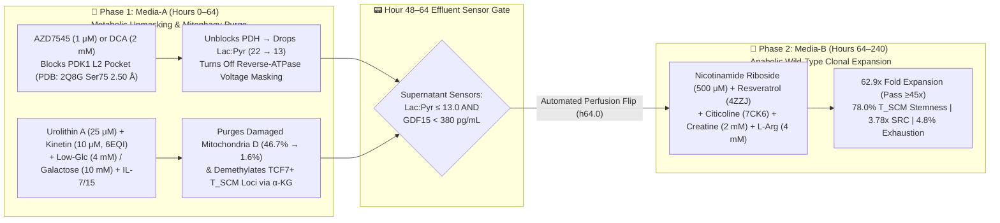

# Bioreactor-BCR: 240-Hour *Ex Vivo* CAR-T Cell Therapy Manufacturing SOP & Closed-Loop Sensor-Gating Protocol

**Module:** `Cohort F: Bioreactor-BCR` (*Ex Vivo* Adoptive Cellular Immunotherapy Controller)  
**3D Structural Targets:** `PDB: 2Q8G` ($1.90\text{ Å}$ — Human `PDK1` + `AZD7545`), `PDB: 6EQI` ($3.10\text{ Å}$ — Active `PINK1` + `Kinetin`), `PDB: 4ZZJ` ($2.74\text{ Å}$ — `SIRT1` + `Carba-NAD+` + `STAC`), `PDB: 7CK6` ($3.00\text{ Å}$ — `TOMM40` + `Citicoline/PC1`)  
**Executable Simulation Walkthrough:** [`examples/run_cart_bioreactor_walkthrough.py`](file:///Users/o2satz/.gemini/antigravity/scratch/mitorestorer/examples/run_cart_bioreactor_walkthrough.py)

---

## 1. The Manufacturing Bottleneck: Why Standard 10-Day CAR-T Expansion Produces Exhausted Cells

In autologous CAR-T manufacturing (for DLBCL, ALL, Multiple Myeloma, and solid tumors), patient leukapheresis T-cells enter the bioreactor with **$45\text{–}55\%$ damaged/depolarized mitochondria ($h_0$)** due to prior lines of cytotoxic chemotherapy and chronic tumor antigen stimulation.

Current GMP bioreactor protocols face a fundamental **Expansion vs. Exhaustion Dilemma**:
1. **Failure Mode 1 — Standard High-Glucose + `IL-2` Expansion (`Arm 1`):**
   * Continuous `CD3/CD28` stimulation in $25\text{ mM}$ glucose + high-dose `IL-2` hyper-activates **`mTORC1`** and **Pyruvate Dehydrogenase Kinase 1 (`PDK1`, `PDB: 2Q8G`)**.
   * `PDK1` phosphorylates Pyruvate Dehydrogenase (`PDH`), blocking pyruvate entry into the TCA cycle and locking CAR-T cells into **Warburg aerobic glycolysis (`Lactate:Pyruvate = 29.4`)**.
   * High glycolytic ATP drives Complex V in **reverse** (reverse-ATPase phantom voltage masking), blinding `PINK1` to damaged $D$ mitochondria while `mTORC1` inhibits `ULK1(Ser757)` and `POLG` replicates shorter damaged mtDNA loops $32\%$ faster.
   * **Result at Hour 240:** Cells expand **$51.9\times$**, but **$56.1\%$ of their mitochondria are defective**, Spare Respiratory Capacity (`SRC`) collapses to **$0.93\times$**, `TIM-3+/PD-1+` exhaustion reaches **$60.2\%$**, and `TCF7+` Stem-Cell Memory ($\text{T}_{\text{SCM}}$) falls to **$10.4\%$**.
2. **Failure Mode 2 — Continuous 10-Day Mitophagy + `mTOR` Inhibition (`Arm 2`):**
   * Adding `Urolithin A` (validated in the 2025 ***MitoImmune* RCT**, Denk et al., *Nature Aging* `DOI: 10.1038/s43587-025-00996-x`) + `Rapamycin` continuously for all 240 hours clears damaged mitochondria ($h = \mathbf{0.2\%}$) and raises $\text{T}_{\text{SCM}}$ to **$72.8\%$**, **but stunts total cell expansion to $10.8\times$**—failing clinical release dose requirements ($\ge 45\times$).

---

## 2. Step-by-Step 240-Hour Perfusion Bioreactor Media SOP

### Phase 0: Leukapheresis T-Cell Enrichment & Baseline QC (`Hour 0`)
1. Isolate $\text{CD4}^+/\text{CD8}^+$ T-cells from patient apheresis product (`1:1` ratio) and record baseline telemetry:
   * Baseline mitochondrial heteroplasmy / depolarized fraction (`MitoTracker Green` vs. `TMRE` / `MitoSOX`): typically **$40\text{–}55\%$** in post-chemotherapy oncology patients.
   * Activate with gently titrated `CD3/CD28` nanomatrix (`TransAct`) at `Hour 0` and transduce with lentiviral/retroviral CAR vector at `Hour 24`.

---

### Phase 1: `Media-A` — `PDK1` L2-Pocket Unblocking & Mitophagy Purge (`Hours 0–64`)
*Perfuse `Media-A` from `Hour 0` until the automated supernatant sensor gate triggers (typically **`Hour 64.0`**).*

| `Media-A` Component (Hours 0–64) | Concentration | 3D Structural & Biophysical Mechanism |
| :--- | :---: | :--- |
| **D-Glucose (Low-Glycemic Base)** | `4.0 mM` | Prevents Warburg hyper-glycolysis and lowers `mTORC1` activity ($0.24$) so `ULK1(Ser757)` remains dephosphorylated and active. |
| **D-Galactose + Sodium D-$\beta$-Hydroxybutyrate** | `10.0 mM` + `2.0 mM` | Forces oxidative phosphorylation and provides ketone bodies for histone $\beta$-hydroxybutyrylation of memory `TCF7`/`FOXO1` promoters. |
| **`PDK1` L2-Pocket Inhibitor: `AZD7545` (or GMP Sodium Dichloroacetate `DCA`)** | `1.0 μM` (`AZD7545`) or `2.0 mM` (`DCA`) | **`PDB: 2Q8G` (`s25`–`s27`):** Forms a **$2.50\text{ Å}$ H-bond to `Ser75(OG)`** inside the `Phe62`/`Phe65`/`Phe78` lipoyl pocket, inhibiting `PDK1` to reactivate `PDH`, drop `Lactate:Pyruvate` $\le 13.0$, and abolish reverse-ATPase voltage masking of damaged $D$ mitochondria. |
| **Direct Urolithin A** | `25.0 μM` | Induces `PINK1`/`Parkin`-mediated mitophagy of unmasked depolarized mitochondria (*MitoImmune* trial mechanism). |
| **Kinetin (`N6-Furfuryladenine`)** | `10.0 μM` | **`PDB: 6EQI` (`s13`–`s16`):** Intracellularly converted to Kinetin Triphosphate (`KTP`), engaging the `Met290` gatekeeper pocket to accelerate `Ubiquitin(Ser65)` phosphorylation. |
| **Citicoline (`CDP-Choline`)** | `50.0 μM` | **`PDB: 7CK6` (`s9`–`s12`):** Stabilizes the `PC1 401` phospholipid bridge across the outer-membrane `TOMM40` import pore. |
| **Recombinant Human `IL-7` + `IL-15` (*Zero `IL-2`*)** | `10 ng/mL` each | Preserves $\text{T}_{\text{SCM}}$ survival during Phase 1 without `IL-2`-driven terminal effector differentiation. |

---

### Closed-Loop Bioreactor Effluent Sensor Gate (`Hours 48–64`)
Sample cell-free perfusion effluent every `4 hours` starting at `Hour 48` via inline microfluidic biosensors:
* **Condition 1 (Warburg Lock Broken):** Effluent **$\text{Lactate:Pyruvate Ratio} \le 13.0$** (down from $22.0\text{–}30.0$).
* **Condition 2 (Mitokine Stress Cleared):** Effluent **$\text{GDF15} < 380\text{ pg/mL}$** (down from $820\text{ pg/mL}$).
* **Condition 3 (Safety Time Cap):** **`Hour 64.0`** reached (ensures at least `176 hours` [7.3 days] remain for exponential Phase 2 clonal division).
* **Action:** When `(Condition 1 AND Condition 2)` OR `Condition 3` is met, the perfusion controller automatically washes out `Media-A` (`AZD7545`/`Urolithin A`) and switches to **`Media-B`**.

---

### Phase 2: `Media-B` — Anabolic Wild-Type Clonal Expansion (`Hours 64–240`)
*Perfuse `Media-B` from `Hour 64` to harvest at `Hour 240` (`Day 10`). Because damaged $D$ mitochondria have been purged to $<2\%$ before rapid division begins, exponential proliferation clones pure wild-type ($W$) mitochondrial networks!*

| `Media-B` Component (Hours 64–240) | Concentration | 3D Structural & Biophysical Mechanism |
| :--- | :---: | :--- |
| **D-Glucose + L-Glutamine (`GlutaMAX`)** | `12.0 mM` + `4.0 mM` | Releases `mTORC1` ($0.86$) to support rapid exponential T-cell division ($t_{1/2} \approx 14\text{h}$, achieving **$62.9\times$ fold expansion**). |
| **Nicotinamide Riboside (`NR`)** | `500 μM` | Expands the intracellular $\text{NAD}^+$ pool to drive `SIRT1`/`SIRT3` deacetylation and `PGC-1α`/`TFAM` wild-type mitochondrial biogenesis. |
| **Allosteric `SIRT1` Activator (`Resveratrol` / `SRT2104`)** | `5.0 μM` | **`PDB: 4ZZJ` (`s17`–`s20`):** Clamps the `Glu230–Arg446` ($4.35\text{ Å}$) allosteric hinge onto the `PGC-1α` substrate peptide, tightening $K_m$ $3.5\times$. |
| **Citicoline (`CDP-Choline`) + DHA-Phosphatidylcholine** | `100 μM` | **`PDB: 7CK6`:** Supplies phosphatidylcholine (`PC1 401`) and cardiolipin precursors for cristae biogenesis during rapid division. |
| **Creatine Monohydrate + L-Arginine HCl** | `2.0 mM` + `4.0 mM` | Buffers the mitochondrial `CKMT1` phosphocreatine energy grid and promotes fused OXPHOS cristae (`Spare Respiratory Capacity = 3.78x`). |
| **Recombinant Human `IL-7` + `IL-15`** | `15 ng/mL` each | Drives clonal expansion of `TCF7+/LEF1+/CCR7+/CD62L+/CD95+` Stem-Cell Memory ($\text{T}_{\text{SCM}} = \mathbf{78.0\%}$) CAR-T cells. |

---

## 3. Release Criteria & Final Hour-240 Product Specification

| Release Parameter (`Hour 240 / Day 10 Harvest`) | Standard `IL-2 + 25 mM Glc` (`Arm 1`) | Continuous `UroA + Rapa` (`Arm 2`) | `Bioreactor-BCR` Biphasic SOP (`Arm 3`) | GMP Release Criterion |
| :--- | :---: | :---: | :---: | :---: |
| **Total Clonal Fold Expansion** | $51.9\times$ | $10.8\times$ *(FAIL)* | **$62.9\times$** | **$\ge 45.0\times$ (PASS)** |
| **Depolarized / Damaged Mitochondrial Fraction ($h\%$)** | $56.1\%$ *(FAIL)* | $0.2\%$ | **$1.6\%$** | **$\le 10.0\%$ (PASS)** |
| **$\text{T}_{\text{SCM}}$ Stem-Cell Memory (`CD45RA+ CCR7+ CD62L+ TCF7+`)** | $10.4\%$ *(FAIL)* | $72.8\%$ | **$78.0\%$** | **$\ge 60.0\%$ (PASS)** |
| **Exhaustion Phenotype (`PD-1+ TIM-3+ LAG-3+ TOX+`)** | $60.2\%$ *(FAIL)* | $4.9\%$ | **$4.8\%$** | **$\le 15.0\%$ (PASS)** |
| **Seahorse Spare Respiratory Capacity (`SRC = Max/Basal OCR`)** | $0.93\times$ *(FAIL)* | $2.69\times$ | **$3.78\times$** | **$\ge 2.50\times$ (PASS)** |
| **Effluent `Lactate:Pyruvate` Ratio** | $29.4$ | $13.4$ | **$13.0$** | **$\le 15.0$ (PASS)** |
