# MitoRestorer v3.0 — Publishing, Deployment & Automated Research Radar Guide

This document explains how **MitoRestorer v3.0** handles **live and scheduled scientific research searches**, how to **publish the showcase and 9 interactive simulators** to **`*.ai.studio`** (Google AI Studio / Cloud Run) and **GitHub Pages**, and how **automatic vs. manual updates** propagate to your live deployed apps.

---

## Part 1: 3-Tier Research Search & Literature-to-ODE Update Architecture

MitoRestorer continuously ingests new scientific literature, clinical-trial readouts, and 3D structural data across three complementary layers:

```mermaid
flowchart TD
    subgraph Tier1["Tier 1: Real-Time Browser Search (Instant)"]
        U["User Enters DOI / PMID / Query in Browser"] --> EPMC["Live EuropePMC & CrossRef REST APIs"]
        EPMC --> ODE["8-to-10 State ODE Lever Classifier (EP = eR * f^2)"]
        ODE --> SIM["4-Way Trajectory Simulation (Baseline vs Paper vs BCR v2.0 vs v3.0 Synergy)"]
    end

    subgraph Tier2["Tier 2: Automated Weekly Cron Schedule (Mondays 08:00 UTC)"]
        CRON["GitHub Actions Cron (.github/workflows/weekly-science-radar.yml)"] --> PY["assess_new_science_release.py --weekly-digest"]
        PY --> TEST["30/30 Verification Suite (tests/run_all_verifications.py)"]
        TEST --> JSON["Commits docs/weekly_science_radar_feed.json to GitHub main"]
        JSON --> SYNC["Auto-Synced by *.ai.studio (server.js) & Browser UI (syncWeeklyRadarFeed)"]
    end

    subgraph Tier3["Tier 3: Deep Agentic 7-Database Sweeps"]
        AG["Antigravity Agent / /schedule Command"] --> DB["ClinicalTrials.gov APIv2 + PubMed + EuropePMC + bioRxiv + RCSB PDB + AlphaFold + Mol-1"]
        DB --> CIF["New 3D Crystal Structures (structures/*.cif) & New ODE State Variables"]
    end
```



### 1. Tier 1 — Real-Time On-Demand Browser Search & ODE Injection (Instant / Anytime)
Whenever any user pastes a **DOI**, **PMID**, or **search keyword** into our flagship apps or the Science Radar Lab, the browser queries the scientific literature directly and compiles the paper into our differential equation engine in real time:
- **Where it runs:**
  - **Flagship #1 (Parkinson's SNc):** [simulator/parkinsons_simulator.html](file:///Users/o2satz/.gemini/antigravity/scratch/mitorestorer/simulator/parkinsons_simulator.html#L173-L180) (*"Live Science Radar & Literature-to-ODE Sandbox"* panel)
  - **Flagship #2 (Honeybee Apis-BCR):** [simulator/apis_honeybee_simulator.html](file:///Users/o2satz/.gemini/antigravity/scratch/mitorestorer/simulator/apis_honeybee_simulator.html#L151-L158) (*"Live Honeybee Science Radar & Literature-to-ODE"* panel)
  - **Dedicated Full-Screen Sandbox:** [simulator/science_radar_sandbox.html](file:///Users/o2satz/.gemini/antigravity/scratch/mitorestorer/simulator/science_radar_sandbox.html#L70-L82)
- **How it works:**
  1. Queries the live **EuropePMC REST API** (`https://www.ebi.ac.uk/europepmc/webservices/rest/search`) and **CrossRef DOI API** (`https://api.crossref.org/works/{doi}`) directly from the client browser.
  2. Parses the title, abstract, and metadata to classify which biophysical lever(s) the paper targets across our 8-state (`Apis`) or 10-state (`Human PD`) ODE system ($\text{EP} = \dot{e}_R \cdot f^2$):
     - **State $H$:** Mitophagy / `PINK1`–`Parkin` quality control ($k_{\text{clear}}$)
     - **State $R$:** Electron transport chain resistance / `NDUFS2` / `SDHB` ($\dot{e}_R$)
     - **State $D$:** `cGAS`–`STING` / IMD innate immune danger signaling
     - **State $E$:** `TET1/2/3` $\alpha\text{-KG}$ epigenetic clock rejuvenation ($k_{\text{rejuv}}$)
     - **State $M$:** GCase / lysosomal ER-to-Golgi folding rescue
     - **State $C$:** Phosphocreatine (`PCr`) spatial ATP buffering & `GAMT` SAMe methylation sink
  3. Runs a **4-way head-to-head ODE simulation** (`Untreated Baseline` vs. `Paper Monotherapy` vs. `Phased BCR v2.0` vs. `Phased BCR v3.0 + Paper Synergy`) and outputs a mechanistic verdict (e.g., whether an unphased monotherapy triggers a **Biogenesis Trap** or **Methylation Sink**).

### 2. Tier 2 — Automated Weekly Cron Schedule (`Every Monday at 08:00 UTC`)
- **GitHub Actions Cron Workflow:** [.github/workflows/weekly-science-radar.yml](file:///Users/o2satz/.gemini/antigravity/scratch/mitorestorer/.github/workflows/weekly-science-radar.yml)
  - **Schedule:** `cron: "0 8 * * 1"` (**Every Monday at 08:00 UTC**, plus manual one-click trigger via `workflow_dispatch` in the GitHub Actions tab).
- **Python Engine:** [`run_weekly_automated_digest()`](file:///Users/o2satz/.gemini/antigravity/scratch/mitorestorer/simulator/assess_new_science_release.py#L653-L718) in [simulator/assess_new_science_release.py](file:///Users/o2satz/.gemini/antigravity/scratch/mitorestorer/simulator/assess_new_science_release.py)
  - Loops through [`WEEKLY_RADAR_WATCH_QUERIES`](file:///Users/o2satz/.gemini/antigravity/scratch/mitorestorer/simulator/assess_new_science_release.py#L586-L650) across 5 watch domains:
    1. **Parkinson's Mitochondrial Bioenergetics & Mitophagy** (`PINK1`, `Parkin`, `USP30`, `NDUFS2`, `ambroxol`)
    2. **Brain Tissue Hyperoxia & HIF-2$\alpha$ / Oxygen Shield** (`hyperoxia`, `hypoxia`, `EPAS1`, `HIF-2`)
    3. **Mitochondrial Creatine Kinase (`uMtCK` / `CKMT1A`) & Axonal PCr Shuttle** (`creatine kinase`, `phosphocreatine`, `SLC6A8`)
    4. **Neuronal Epigenetic Clock & $\alpha\text{-KG}$ Demethylation** (`epigenetic clock`, `epigenetic age`, `ketoglutarate`)
    5. **Honeybee (`Apis mellifera`) Thoracic Mitochondria & Holobiont Rescue** (`Apis mellifera`, `mitochondria`, `fungicide`, `Snodgrassella`)
  - Runs the full `30 / 30` verification suite ([tests/run_all_verifications.py](file:///Users/o2satz/.gemini/antigravity/scratch/mitorestorer/tests/run_all_verifications.py)) and commits the updated feed to [docs/weekly_science_radar_feed.json](file:///Users/o2satz/.gemini/antigravity/scratch/mitorestorer/docs/weekly_science_radar_feed.json).

### 3. Tier 3 — Deep Agentic 7-Database Sweeps & Local `/schedule` Automation
When a paper or clinical trial uncovers a brand-new structural bottleneck or missing state variable (such as our **Creatine + SAMe Methylation Sparing** discovery in [docs/proactive_blindspot_audit.md](file:///Users/o2satz/.gemini/antigravity/scratch/mitorestorer/docs/proactive_blindspot_audit.md)), we run a deep cross-database agentic audit across:
1. **ClinicalTrials.gov APIv2** (`clinical-trials-database`) — auditing Phase II/III inclusion criteria, dosing, and failure modes.
2. **PubMed / EuropePMC / bioRxiv** (`pubmed-database`, `literature-search-europepmc`, `literature-search-biorxiv`) — extracting kinetic rates ($K_m$, $IC_{50}$, Hill coefficients).
3. **RCSB PDB / AlphaFold / [`molence/Mol-1`](https://github.com/molence/Mol-1)** (`pdb-database`, `alphafold-database-fetch-and-analyze`) — pulling 3D crystal coordinates into [structures/](file:///Users/o2satz/.gemini/antigravity/scratch/mitorestorer/structures) and [figures/mol1_cofolding_jobs.json](file:///Users/o2satz/.gemini/antigravity/scratch/mitorestorer/figures/mol1_cofolding_jobs.json).

> [!TIP]
> **Local Antigravity Scheduling:** You can also use the **`/schedule`** slash command directly in the Antigravity chat UI to schedule a recurring local agentic research and ODE-compilation pass.

---

## Part 2: Where & How to Publish the Site and Apps

Your repository (`https://github.com/deesatzed/mitorestorer`) is pre-configured to deploy cleanly to **Google AI Studio (`*.ai.studio`)**, **GitHub Pages**, and **Google Cloud Run**.

### Option A: Publish to `*.ai.studio` via Google AI Studio Build Mode (Like `symbiont.ai.studio`)

Google AI Studio's **Build mode** (`https://aistudio.google.com/build`) packages web apps onto **Google Cloud Run** and lets you claim a free custom **`*.ai.studio`** subdomain (e.g., `https://mitorestorer.ai.studio/`).

The root of your repository includes [metadata.json](file:///Users/o2satz/.gemini/antigravity/scratch/mitorestorer/metadata.json), [package.json](file:///Users/o2satz/.gemini/antigravity/scratch/mitorestorer/package.json), and [server.js](file:///Users/o2satz/.gemini/antigravity/scratch/mitorestorer/server.js) (a zero-dependency Node HTTP server on `process.env.PORT || 8080`).

**4 Steps to Publish on `*.ai.studio`:**
1. **Open Google AI Studio Build Mode:** Go to https://aistudio.google.com/build.
2. **Import from GitHub:** Click the **`+`** button in the lower-left corner of the prompt box → select **Import from GitHub** → choose or paste `https://github.com/deesatzed/mitorestorer` (`main` branch).
3. **Click Publish (🚀 Rocket Icon):** In the top-right corner of the AI Studio Build workspace, click **Publish**.
4. **Claim Your `*.ai.studio` Subdomain:** Enter your desired subdomain (e.g., **`mitorestorer.ai.studio`**) and click **Publish App**. AI Studio provisions the Cloud Run service and serves [index.html](file:///Users/o2satz/.gemini/antigravity/scratch/mitorestorer/index.html), all 9 simulators in [simulator/](file:///Users/o2satz/.gemini/antigravity/scratch/mitorestorer/simulator), the 3 SVG figures in [figures/](file:///Users/o2satz/.gemini/antigravity/scratch/mitorestorer/figures), and all 11 3D `.cif` structures in [structures/](file:///Users/o2satz/.gemini/antigravity/scratch/mitorestorer/structures).

### Option B: Publish to GitHub Pages (`https://deesatzed.github.io/mitorestorer/`)
- **Files Included:** [.nojekyll](file:///Users/o2satz/.gemini/antigravity/scratch/mitorestorer/.nojekyll) and [.github/workflows/deploy-pages.yml](file:///Users/o2satz/.gemini/antigravity/scratch/mitorestorer/.github/workflows/deploy-pages.yml).
- **One-Time Activation:** Go to `https://github.com/deesatzed/mitorestorer/settings/pages` and set **Build and deployment → Source** to **GitHub Actions**.

### Option C: Direct Google Cloud Run CLI Deployment
Because [package.json](file:///Users/o2satz/.gemini/antigravity/scratch/mitorestorer/package.json) and [server.js](file:///Users/o2satz/.gemini/antigravity/scratch/mitorestorer/server.js) are in the repository root, you can also deploy directly to any Google Cloud project via:
```bash
gcloud run deploy mitorestorer --source . --region us-central1 --allow-unauthenticated
```

---

## Part 3: How Updates Propagate to the Published App (Automatic vs. Manual)

### 1. Automatic Weekly Research Searches (100% Hands-Free — Zero Republishing Needed)

When you publish an app to **`*.ai.studio`**, the container itself is a snapshot of your code at the time you clicked **Publish (🚀)**. However, because of our **live GitHub-to-Cloud-Run feed bridge**, weekly literature updates bypass the container snapshot completely:

1. **Monday `08:00 UTC` GitHub Actions Run:**
   - [.github/workflows/weekly-science-radar.yml](file:///Users/o2satz/.gemini/antigravity/scratch/mitorestorer/.github/workflows/weekly-science-radar.yml) runs [`run_weekly_automated_digest()`](file:///Users/o2satz/.gemini/antigravity/scratch/mitorestorer/simulator/assess_new_science_release.py#L653-L718) and commits the new [docs/weekly_science_radar_feed.json](file:///Users/o2satz/.gemini/antigravity/scratch/mitorestorer/docs/weekly_science_radar_feed.json) to `github.com/deesatzed/mitorestorer` (`main` branch).
2. **Server-Side Live Proxy ([`serveLatestRadarFeed`](file:///Users/o2satz/.gemini/antigravity/scratch/mitorestorer/server.js#L32-L91) in [server.js](file:///Users/o2satz/.gemini/antigravity/scratch/mitorestorer/server.js)):**
   - Whenever a visitor requests `/docs/weekly_science_radar_feed.json` on your `*.ai.studio` site, [server.js](file:///Users/o2satz/.gemini/antigravity/scratch/mitorestorer/server.js) fetches the freshest JSON directly from `https://raw.githubusercontent.com/deesatzed/mitorestorer/main/docs/weekly_science_radar_feed.json` (with a 5-minute cache and automatic local-disk fallback).
3. **Client-Side Auto-Sync ([`syncWeeklyRadarFeed()`](file:///Users/o2satz/.gemini/antigravity/scratch/mitorestorer/simulator/science_radar_sandbox.html#L860-L904) in [simulator/science_radar_sandbox.html](file:///Users/o2satz/.gemini/antigravity/scratch/mitorestorer/simulator/science_radar_sandbox.html)):**
   - On page load (or when clicking **"🔄 Sync Weekly Digest Now"**), the browser fetches the latest `weekly_science_radar_feed.json` and renders clickable paper pills that load and simulate each new discovery directly in the ODE engine.

### 2. Manual Code & UI Updates (When Adding New Features, Simulators, or 3D Structures)

| Hosting Target | How Manual Code Updates Propagate |
| :--- | :--- |
| **GitHub Pages (`deesatzed.github.io/mitorestorer`)** | **100% Automatic on `git push`:** Every commit pushed to `main` triggers [.github/workflows/deploy-pages.yml](file:///Users/o2satz/.gemini/antigravity/scratch/mitorestorer/.github/workflows/deploy-pages.yml) and updates the live site in ~30 seconds. |
| **Google AI Studio (`*.ai.studio`)** | **2-Click Sync in AI Studio:** After pushing major UI/code changes to GitHub:<br>1. Open your project in [Google AI Studio Build](https://aistudio.google.com/build) and click **⚙️ GitHub → Pull from GitHub**.<br>2. Click **Publish (🚀) → Update App** to deploy the updated container revision to your existing `*.ai.studio` URL. |
